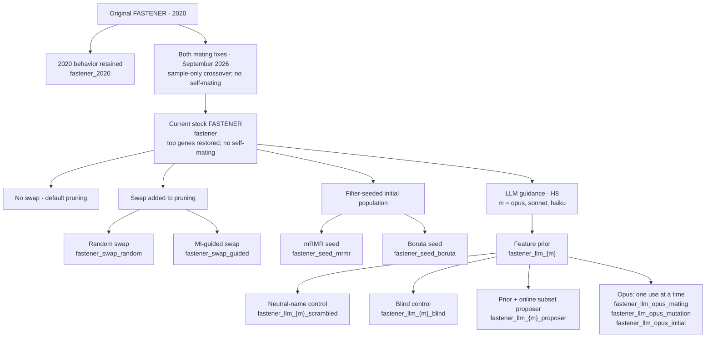

# FASTENER 
> FeAture SelecTion ENabled by EntRopy

FASTENER is a genetic algorithm for feature selection. It wraps any model
with `fit` and `predict`, and any score. It searches for the best feature
subset of every size at once, and returns a Pareto front: one subset per
size, each scoring strictly better than every smaller one. Mutual information
between features and the target guides the crossover. Permutation importance
guides the pruning of the front, which tries dropping the weakest feature of
each subset. Optionally, a large language model guides the search as well
(see [LLM guidance](#llm-guidance)). It works for classification and, with a regression estimate of
mutual information, for [regression](docs/regression.md).

```python
from fastener import Config, EntropyOptimizer
from item import (IntersectionMatingWithWeightedRandomInformationGain,
                  RandomEveryoneWithEveryone, RandomFlipMutationStrategy)

n = X_train.shape[1]
optimizer = EntropyOptimizer(
    DecisionTreeClassifier, X_train, y_train, evaluator, n,
    RandomEveryoneWithEveryone(
        pool_size=3,
        mating_strategy=IntersectionMatingWithWeightedRandomInformationGain()),
    RandomFlipMutationStrategy(1 / n),
    initial_genes=[[i] for i in range(n)],
    config=Config(output_folder="my_run", random_seed=2020, number_of_rounds=100))
optimizer.mainloop()
optimizer.pareto_front        # {size: EvalItem}, the best subset per size
```

`evaluator(model, genes, shuffle_indices=None)` scores the fitted model on
validation data and returns `Result(score)`, where higher is better. See the
[quickstart](docs/examples/01_quickstart.py) for a complete one.

## Variants

### Lineage and experiment map

The available Git history has one development line (`master`), from the
2020 implementation to the current component. The branches below are
**algorithm configurations**, rather than separate Git branches. Optional
operators can be combined; the tree groups them by what they change.
Experiment labels follow the companion workspace's `experiments/run_fastener.py`
and `experiments/run_sota.py` (inventory as of 2026-10-30).



#### Historical mating variants

These flags distinguish historical versions even when their experiment
records use the same `fastener` label. Both belong to the mating strategies.

| Version | `include_top_genes` | `allow_self_mating` | History / experiment use |
|---|---|---|---|
| Original 2020 behavior | `True` | `True` | Initial implementation `3ddf707`; current compatibility arm `fastener_2020`, compared in H0. |
| Both mating fixes | `False` | `False` | `564eb8a` through `144621c`; early H0 runs used this as `fastener`. Weighted crossover adds only its sample to the intersection. |
| Current stock behavior | `True` | `False` | Since `08e6acd`: mandatory top genes restored; self-mating still disabled. Later stock and derived arms use this version. |

The fourth combination (`False`, `True`) is configurable but is not a named
arm in the current registry. Matching the flags restores the mating
behavior; reproducing a particular run also requires matching its data
split, model, evaluator and initial population. See [CHANGELOG.md](CHANGELOG.md) for compatibility details.

#### Implemented variant families

| Family / experiment label | Change from current stock | Component API and experiment use |
|---|---|---|
| Stock: `fastener` | Weighted MI crossover, uniform bit-flip mutation, permutation-importance deletion pruning; no extra guidance. | `swap_strategy=None`, `seed_filter=None`, no prior or proposer. The harness normally starts from five random singletons; the component accepts `initial_genes`. |
| Random swap: `fastener_swap_random` | Also replaces a random selected feature with a uniformly random unselected feature. | `RandomSwapStrategy`; H2 and later comparisons. |
| Guided swap: `fastener_swap_guided` | Also replaces the permutation-weakest feature with an unselected feature sampled by MI. | `InformationGainSwapStrategy`; H3 and later comparisons. Each swap candidate consumes a fit. |
| mRMR seed: `fastener_seed_mrmr` | Starts from nested top-k subsets of an mRMR ranking. | `seed_filter="mrmr"`, `seed_size=10`; H10. |
| Boruta seed: `fastener_seed_boruta` | Starts from nested top-k subsets of a Boruta ranking. | `seed_filter="boruta"`, `seed_size=10`; H10, H11. Boruta's ranking fits are charged to the budget. |
| LLM prior: `fastener_llm_{m}` | Mixes MI with a relevance prior, guiding mating, mutation and five initial singletons. | `feature_prior`, `prior_weight=0.5`, `prior_uses=("mating", "mutation", "initial")`, `PriorGuidedMutationStrategy`; H8. |
| Neutral-name control: `fastener_llm_{m}_scrambled` | The prior sees neutral feature names and no feature descriptions; column order, task, classes and dataset description remain. | A different input prior through the same guidance API; H8. |
| Blind control: `fastener_llm_{m}_blind` | Also removes the dataset description and shuffles feature presentation order, naming features only by position. | A different input prior through the same guidance API; H8-E02 onward. |
| Prior + proposer: `fastener_llm_{m}_proposer` | Adds online subset suggestions to the full prior-guided search. | `subset_proposer`, `proposer_every=5`; the harness requests five subsets per call. Suggestions share the evaluation budget. |
| Single-use prior: `fastener_llm_opus_mating`, `fastener_llm_opus_mutation`, `fastener_llm_opus_initial` | Applies the Opus prior to only the named part of the search. | A one-element `prior_uses`; H8 operator ablations. |

Here `{m}` expands to each of `opus`, `sonnet` and `haiku`, the model aliases
in the registry. There are **21 registered arms**: six stock, compatibility,
swap and seed arms; twelve LLM arms (four per model); and three Opus
ablations. Registration describes available configurations, not evidence
that every arm has a completed run.

The component's seed API adds filter prefixes to `initial_genes`. The
H10/H11 harness constructs the prefixes externally and passes them as the
initial population, replacing the random singletons; it also deducts
Boruta's ranking fits from the remaining search budget. Match these initial
populations when comparing seeded runs.

#### Options that apply across the tree

- **Other operators:** `UnionMating`, `IntersectionMating`,
  `IntersectionMatingWithInformationGain`, weighted MI mating and `NoMating`
  (mutation-only search) are supported choices, without separate named arms
  in the current registry. See the [operator reference](docs/reference.md).
- **Model and task:** decision tree, random forest, LightGBM and ELM are
  experiment model choices. The harness appends `_elm` for ELM runs.
  [Regression](docs/regression.md) uses a regressor, a higher-is-better
  evaluator and a regression MI hook; it is a runnable component example,
  without a registered regression experiment arm.
- **Run controls:** round limits, `Config.max_model_fits`, the harness CPU-time
  cap, trajectory recording and bounded model cache apply across variants.
  Fit and CPU budgets define different comparisons; record them with the arm.
- **Implementation revisions:** pruning counters (`b7e724d`), vectorised
  bookkeeping (`3877a1a`) and faster equivalent MI (`3be5697`) add observability
  or speed while preserving search behavior. Filter seeds (`8f527ca`) and
  outside guidance (`5261cd0`) add the optional families above.

NSGA-II, POSS, FS-SDS, standalone mRMR and standalone Boruta are independent
competitors. For run definitions and evidence, consult the companion
workspace's `experiments/HYPOTHESES.md`, `experiments/reports/LIST.md` and
per-run manifests, which record both repositories' revisions.

### Configuring variants

The call above is the base algorithm. Each variant below is one optional
argument, off by default, and the variants combine freely. They come in two
kinds: variants of the search operators, and LLM guidance.

### Search operators

| Variant | Argument | What it changes |
|---|---|---|
| Swap in pruning | `swap_strategy=` | Pruning also tries replacing the weakest feature with an unselected one, sampled by mutual information or at random. |
| Filter seed | `seed_filter="mrmr"` / `"boruta"` | The search starts from the filter's nested top-k subsets. Boruta needs `pip install Boruta`. |
| Other operators | `mating_selection_strategy`, `mutation_strategy` | Union or intersection mating, other pool sizes and mutation rates, or your own classes. |

```python
from item import InformationGainSwapStrategy, RandomSwapStrategy

# Swap in pruning: guided by mutual information, or random (the ablation)
EntropyOptimizer(..., swap_strategy=InformationGainSwapStrategy())
EntropyOptimizer(..., swap_strategy=RandomSwapStrategy())

# Filter seed: start from mRMR's or Boruta's top 10 nested subsets
EntropyOptimizer(..., seed_filter="mrmr", seed_size=10)
EntropyOptimizer(..., seed_filter="boruta", seed_size=10, boruta_max_iter=100)
```

### LLM guidance

FASTENER can be guided by a large language model. The LLM brings what the
data cannot show: what the features mean, and what is known about the task.
It enters the algorithm at two points.

| Part of the algorithm | Argument | What the LLM does | When |
|---|---|---|---|
| **Feature prior** | `feature_prior=` | Reads the feature names, the task description and any feature descriptions, and scores each feature's likely relevance. FASTENER combines the scores with mutual information, `w = MI^(1 − λ) · prior^λ` with `λ = prior_weight`, and uses `w` to choose the genes a child inherits in mating, to bias mutation, and to draw extra single-feature starting subsets. | Once, before the search |
| **Subset proposer** | `subset_proposer=` | Reads the current Pareto front (the features and validation score of the best subset of each size) and proposes new subsets. FASTENER evaluates them like any other candidate, and they compete for the front. | Every `proposer_every` generations |

The LLM never scores a subset: every score still comes from fitting your
model and running your evaluator. With `λ = 0` the mating weights are mutual
information alone, as without guidance. With `λ = 1` they are the LLM's
scores alone. FASTENER records what the LLM contributed:
`optimizer.prior_scores` holds the prior, and `optimizer.proposal_log` holds
every proposal with its scores and the fits it cost.

Both parts take a plain Python function, so any model and any provider will
do, and FASTENER itself makes no network calls.
[docs/examples/08_llm_guidance.py](docs/examples/08_llm_guidance.py)
implements both through OpenRouter, with a minimal client, the prompts and
reply parsing. `LLMFeaturePrior` and `LLMSubsetProposer` below are its two
classes; copy them as a starting point. [docs/llm-guidance.md](docs/llm-guidance.md)
explains both parts in full.

```python
from guidance import GuidanceContext, PriorGuidedMutationStrategy

# What the LLM is told about the problem
context = GuidanceContext(
    n_features=n, feature_names=names,
    task="Classify land cover from Sentinel-2 spectral bands",
    class_names=classes,
    metadata={"feature_descriptions": {...}})     # optional data dictionary

optimizer = EntropyOptimizer(
    ..., PriorGuidedMutationStrategy(1 / n),       # mutation that follows the prior
    guidance_context=context,
    feature_prior=LLMFeaturePrior(),               # asks the LLM once
    prior_weight=0.5,
    prior_uses=("mating", "mutation", "initial"),
    subset_proposer=LLMSubsetProposer(),           # asks the LLM every 5 generations
    proposer_every=5)
```

The same two arguments also accept guidance that does not come from an LLM,
such as a domain expert's ranking, another selector's scores, or a rule.

What changed since the 2020 paper, including two bug fixes in mating that
change the default search, and how to reproduce the published behaviour
exactly, is in [CHANGELOG.md](CHANGELOG.md).

## Documentation

The [docs/](docs/README.md) directory documents FASTENER in full:

- [How the search works](docs/concepts.md): the population, the Pareto front, a generation step by step
- [Reference](docs/reference.md): every class, parameter and attribute
- [Examples](docs/examples.md): recipes for each option, with [runnable scripts](docs/examples/)
- [LLM guidance](docs/llm-guidance.md): the feature prior and the subset proposer
- [Regression](docs/regression.md): using FASTENER with a continuous target
- [Pitfalls and questions](docs/pitfalls.md)

## Tests

Unit tests live in `tests/` and need only FASTENER's own requirements plus
pytest. From the repo root:

```
pip install pytest
python -m pytest tests
```

## Citation

If you use FASTENER, please cite the paper:

> Koprivec, F.; Kenda, K.; Šircelj, B. FASTENER Feature Selection for Inference
> from Earth Observation Data. *Entropy* **2020**, 22(11), 1198.
> [doi:10.3390/e22111198](https://doi.org/10.3390/e22111198)

```bibtex
@article{koprivec2020fastener,
  author  = {Koprivec, Filip and Kenda, Klemen and {\v{S}}ircelj, Beno},
  title   = {{FASTENER} Feature Selection for Inference from Earth Observation Data},
  journal = {Entropy},
  volume  = {22},
  number  = {11},
  pages   = {1198},
  year    = {2020},
  doi     = {10.3390/e22111198}
}
```

The Earth observation dataset used in the paper (Sentinel-2 land patch samples
over Slovenia, 2017) is published separately:

> Šircelj, B.; Kenda, K.; Koprivec, F. Land Patch Samples. *PANGAEA* **2020**.
> [doi:10.1594/PANGAEA.914271](https://doi.org/10.1594/PANGAEA.914271) (CC-BY-4.0)

```bibtex
@misc{sircelj2020landpatch,
  author    = {{\v{S}}ircelj, Beno and Kenda, Klemen and Koprivec, Filip},
  title     = {Land Patch Samples},
  publisher = {PANGAEA},
  year      = {2020},
  doi       = {10.1594/PANGAEA.914271}
}
```

### Applications

Published work that applies FASTENER:

- Uku, S.; Kenda, K. Comparative Analysis of Feature Selection and Imbalance
  Handling for Semiconductor Defect Detection on the SECOM Dataset. In
  *Proceedings of Information Society 2026 (SiKDD)*, Ljubljana, Slovenia, 2026.
  [doi:10.70314/is.2026.sikdd.125](https://doi.org/10.70314/is.2026.sikdd.125).
  FASTENER is one of three selectors for semiconductor defect detection on SECOM,
  compared with a Pearson filter and Boruta.
